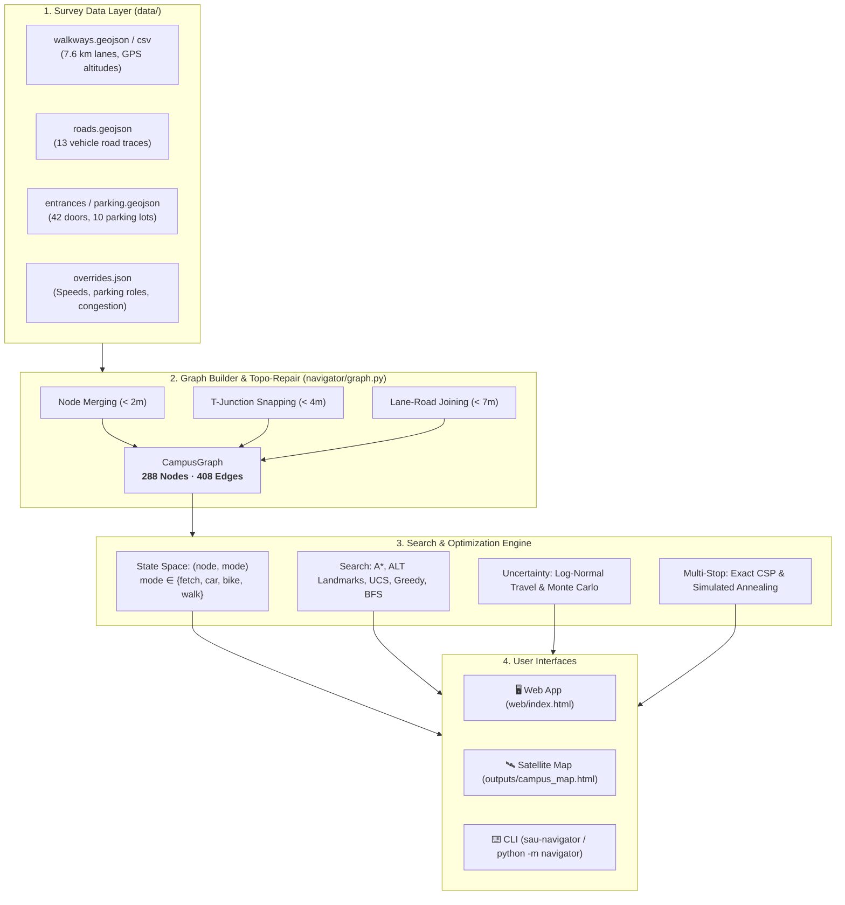
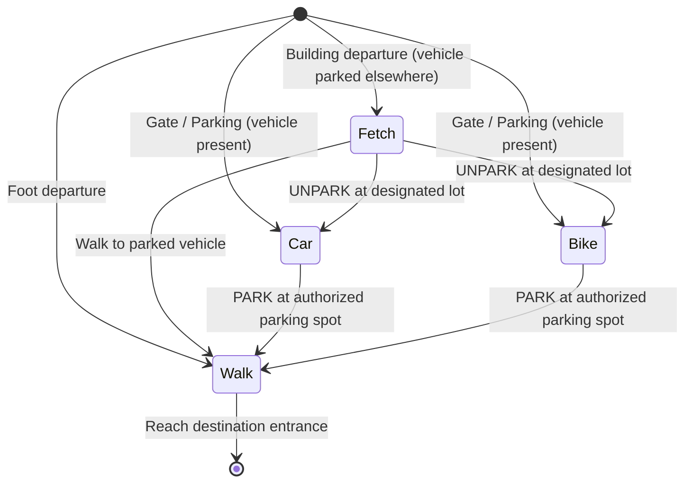

# 🧭 SAU Smart Campus Navigator

[](https://www.python.org/)
[](https://opensource.org/licenses/MIT)
[-brightgreen.svg)]()
[]()
[]()

> An autonomous route-planning AI agent for the **South Asian University (SAU)** campus (Maidan Garhi, New Delhi), built on an exact topological graph surveyed with GPS coordinates.

---

## 📑 Table of Contents

- [Overview & Highlights](#-overview--highlights)
- [System Architecture](#-system-architecture)
- [Quick Start](#-quick-start)
- [1. Campus Graph & Survey Data](#1-campus-graph--survey-data)
  - [Trace Repair & Cleaning](#trace-repair--cleaning)
  - [Movement Model & Access Matrix](#movement-model--access-matrix)
- [2. The AI Agent (PEAS Formulation)](#2-the-ai-agent-peas-formulation)
- [3. Point-to-Point State-Space Search](#3-point-to-point-state-space-search)
  - [Search Algorithms Benchmark](#search-algorithms-benchmark)
  - [Heuristics: Admissibility & ALT Landmarks](#heuristics-admissibility--alt-landmarks)
  - [Multi-Modal Vehicle & Parking Logic](#multi-modal-vehicle--parking-logic)
  - [Accessibility & Dynamic Replanning](#accessibility--dynamic-replanning)
- [4. Travel-Time Uncertainty & Risk-Averse Routing](#4-travel-time-uncertainty--risk-averse-routing)
- [5. Multi-Stop Itinerary Planner (CSP & Local Search)](#5-multi-stop-itinerary-planner-csp--local-search)
- [6. Interactive Web Applications](#6-interactive-web-applications)
- [7. Project Directory Layout](#7-project-directory-layout)
- [8. Assumptions & Limitations](#8-assumptions--limitations)

---

## ✨ Overview & Highlights

The **SAU Smart Campus Navigator** solves multi-modal pathfinding and multi-stop scheduling problems under realistic campus conditions:

* 🚶 **Multi-Modal Transit:** Seamlessly coordinates walking, 2-wheelers (motorcycles/scooters), and 4-wheelers (cars) with real-world parking restrictions and vehicle retrieval delays.
* 🛑 **Dynamic Closures & Online Replanning:** Detects unexpected road obstacles en-route and replans instantly using agent sensor models.
* ♿ **Universal Wheelchair Accessibility:** Strictly avoids stairs and path gradients steeper than $1:12$ (ADA compliant) with grade-dependent speed adjustments.
* ⏱️ **Time-of-Day Traffic & Congestion:** Models stochastic edge traversal times using log-normal distributions across campus rush hours (meal times, class changes, main gate rush).
* 🛡️ **Risk-Averse Routing:** Provides predictable routes optimized for on-time arrival under hard deadlines, proving that *fastest-on-average is not always most reliable*.
* 📅 **Multi-Stop CSP Scheduling:** Formulates and solves the Travelling Salesperson Problem with Time Windows (TSPTW) and precedence constraints via exact Backtracking (with Forward Checking & Branch-and-Bound) and Simulated Annealing.
* ⚡ **Zero Core Dependencies:** All graph processing, heuristics, search routines, CSP solvers, and annealing algorithms are written completely from scratch in standard Python.

---

## 🏗️ System Architecture



---

## ⚡ Quick Start

### 1. Launch the Interactive Web Application
Run a local static server to explore the full interactive application with dark mode, multi-stop planning, and vector map:
```bash
python -m http.server -d web 8000
```
👉 Open your browser at **[http://localhost:8000](http://localhost:8000)**.

> [!TIP]
> You can also directly double-click [web/index.html](file:///c:/Users/user/Desktop/sau_navigator/web/index.html) or [outputs/campus_map.html](file:///c:/Users/user/Desktop/sau_navigator/outputs/campus_map.html) in your browser.

---

### 2. Command-Line Interface (CLI)
The CLI can be invoked directly as a Python module or via the root script:

```bash
# List all 27 campus destinations and 10 parking lots
python -m navigator places

# Multi-modal car route (Drive -> Park -> Walk)
python -m navigator route GATE1 LIBRARY --vehicle car

# Walking route minimizing time
python -m navigator route BOYS_HOSTEL AB4 --algo astar

# Wheelchair accessible route (avoids stairs and slopes > 1:12)
python -m navigator route AMPHITHEATRE KITCHEN --wheelchair

# Departure at 09:55 with risk-averse metric and an 8.1 min deadline
python -m navigator route LIBRARY AB4 --depart 09:55 --metric safe --deadline 8.1

# Simulate a road closure at coordinates with 10 m radius
python -m navigator route BOYS_HOSTEL AB4 --close 28.4846,77.2002,10

# Compare all 8 search algorithms on a route
python -m navigator compare BOYS_HOSTEL AB4

# Plan a multi-stop errand itinerary under opening hours & deadlines
python -m navigator tour BOYS_HOSTEL --depart 09:00 \
    --stop HEALTH@-09:15 \
    --stop ADMIN@09:10-09:20/10 \
    --stop LIBRARY/8 \
    --stop AB3@-10:00 \
    --before LIBRARY:AB3 \
    --end AB4@10:10
```

---

### 3. Run Benchmarks & Visualizations
Execute every scenario, recalculate all-pairs shortest paths, and generate figures and reports:
```bash
python demo.py
```
*Outputs generated:* `outputs/results.md`, `outputs/campus_map.html`, and 9 PNG figures in `outputs/`.

---

### 4. Run the Test Suite
The test suite runs with zero dependencies using standard Python, or with `pytest`:
```bash
# Standalone execution (standard library, zero external dependencies):
python tests/test_navigator.py

# Or with pytest:
python -m pytest -q
```

---

## 1. Data: The Campus Graph

The graph is derived from our own GPS survey using high-precision field exports:

| File (in `data/`) | Source | Description |
|:---|:---|:---|
| `walkways.geojson` / `.csv` | `SAU_Project_1` | **7.6 km lane network** with GPS altitudes. Accessible to pedestrians and 2-wheelers. |
| `roads.geojson` | `SAU_Vehicleonly_Route` | **13 road polylines**. Usable by all modes (cars, bikes, and pedestrians). |
| `entrances.geojson` / `.csv` | `SAU_Project` | **42 physical doorways** and campus entry gates (Gates 1–3). |
| `parking.geojson` | `SAU_Project_2` | **10 parking areas** plus the Boys' Hostel parking approach road. |
| `places.json` | Hand-curated | Groups entrances into **27 distinct campus destinations** (AB1…AB8, LIBRARY, ADMIN, etc.). |
| `overrides.json` | Hand-curated | Ground-truth constraints: stairs, parking authorization rules, speeds, and rush-hour zones. |

### Trace Repair & Cleaning

Hand-clicked survey traces inherently suffer from GPS drift and disconnects. `navigator/graph.py` automatically repairs the topology:

1. **Vertex Merging:** Merges vertices within $2\text{ m}$ of each other to resolve overlapping survey traces.
2. **T-Junction Snapping:** Splices a vertex into an adjacent path if placed within $4\text{ m}$.
3. **Inter-Layer Connectors:** Automatically bridges lanes and roads where they pass within $7\text{ m}$.
4. **Endpoint Snapping:** Connects every building entrance, gate, and parking lot to the nearest navigable edge.

> **Final Graph Topology:** **288 nodes** and **408 edges**. Every building entrance is guaranteed reachable on foot; all 3 gates and 10 parking lots are accessible by vehicle.

### Movement Model & Access Matrix

```
   🚗 Car (4-wheeler)       🏍️ 2-Wheeler (Bike)         🚶 Pedestrian (Walk)
           │                         │                           │
     Roads ONLY                Lanes + Roads               Lanes + Roads
           │                         │                           │
    Must Park in Lot          Must Park in Lot             Direct to Door
           └─────────────────────────┴───────────────────────────┘
```

| Layer Type | Walk | 2-Wheeler | 4-Wheeler (Car) | Notes |
|:---|:---:|:---:|:---:|:---|
| **lane** | ✅ | ✅ | ❌ | Internal footpaths, pedestrian walkways |
| **road** | ✅ | ✅ | ✅ | Vehicular campus roads |
| **entrance link** | ✅ | ❌ | ❌ | Door-to-path connector (last-meter walk) |
| **parking / gate link** | ✅ | ✅* | ✅* | Inherits mode of the road/lane it attaches to |

> [!NOTE]
> Vehicles must be parked in one of the 10 authorized parking locations. The final leg to any building entrance is always on foot.

---

## 2. The AI Agent (PEAS Formulation)

Following standard Russell & Norvig (AIMA) conventions, the navigator is formulated as a goal-directed intelligent agent:

| Dimension | Specification |
|:---|:---|
| **Performance Measure** | Minimal expected travel time (or distance / risk-averse safe cost); 100% adherence to deadlines and opening windows; zero wheelchair violation; maximum on-time arrival probability. |
| **Environment** | Metric SAU campus graph (288 nodes, 408 edges), parking permissions, dynamic road closures, and stochastic time-of-day traffic congestion. |
| **Actuators** | Step-by-step turn-by-turn navigation plans, mode transitions (`UNPARK`, `PARK`, `MOVE`), visiting order sequence, and online replanning triggers. |
| **Sensors** | User query parameters (origin, destinations, vehicle mode, role, accessibility needs, departure time, deadlines) and dynamic closure obstacle reports. |

### Environment Properties
* **Partially Observable:** Road closures may be discovered mid-trip while traveling.
* **Stochastic:** Edge traversal durations vary based on crowds and congestion.
* **Sequential:** Mode decisions (driving vs. parking vs. walking) affect all subsequent states.
* **Dynamic:** Closures and crowd density shift over time.
* **Discrete:** Modeled over a discrete topological graph.
* **Single-Agent:** Plans optimal paths assuming other pedestrians and vehicles form part of the environment.

---

## 3. Point-to-Point State-Space Search

The navigation task is formulated as search over a joint location-mode state space:



* **State Space:** $(n, m)$ where $n \in \text{Nodes}$ and $m \in \{\text{fetch}, \text{car}, \text{bike}, \text{walk}\}$.
  * `fetch`: Walking from an origin to the lot where your vehicle is currently parked.
* **Initial State:**
  * At a gate or parking lot with a vehicle: $(s, \text{car})$ or $(s, \text{bike})$.
  * At a building with a vehicle: $(s, \text{fetch})$.
  * On foot: $(s, \text{walk})$.
* **Actions:**
  * $\text{MOVE}(u \to v)$: Traverse open edge $e = (u, v)$ allowed for current mode $m$.
  * $\text{UNPARK}$: At vehicle node, switch mode $\text{fetch} \to \text{car}$ or $\text{bike}$ (adds unpark delay).
  * $\text{PARK}$: At permitted parking node, switch mode $\text{car} \mid \text{bike} \to \text{walk}$ (adds parking delay).
* **Goal Condition:** Being on foot (`walk` or `fetch`) at **any** valid entrance of the target facility (multi-goal search).
* **Cost Metrics:**
  * `time`: Expected seconds, congestion-adjusted.
  * `distance`: Physical length in meters.
  * `safe`: Mean time $+ k \cdot \sigma$ (risk-averse).

---

### Search Algorithms Benchmark

On a representative query (**Boys' Hostel $\to$ Academic Block 4**, on foot):

| Algorithm | Type | Cost (s) | Optimality | Expanded Nodes | Generated | Max Frontier | Runtime (ms) |
|:---|:---:|:---:|:---:|:---:|:---:|:---:|:---:|
| **BFS** | Uninformed | 585.4 | Suboptimal (steps) | 227 | 638 | 18 | 7.2 |
| **DFS** | Uninformed | 1620.7 | Highly suboptimal | 139 | 422 | 89 | 4.1 |
| **IDDFS** | Uninformed | 624.0 | Suboptimal (steps) | 13,606 | 35,610 | 22 | 233.8 |
| **UCS (Dijkstra)** | Uninformed | **565.3** | **Optimal** | 235 | 662 | 14 | 10.3 |
| **Greedy Best-First** | Informed | 596.4 | Suboptimal ($+5.5\%$) | **29** | 81 | 26 | **1.7** |
| **A\*** | Informed | **565.3** | **Optimal** | 168 | 461 | 39 | 6.1 |
| **Weighted A\* ($w=2$)** | Informed | **565.3** | $\le 2\times$ Bounded | 32 | 86 | 24 | 2.8 |
| **A\* + ALT Landmarks** | Informed | **565.3** | **Optimal** | **80** | 196 | 22 | 6.4 |

#### Average Across All 351 Campus Place Pairs (Walking, Time):

| Algorithm | Average Expanded Nodes | Total Cost vs. Optimal | Optimality Guarantee |
|:---|:---:|:---:|:---:|
| **A\* + ALT Landmarks** | **41.8** | **1.000x** | Guaranteed Optimal |
| **A\*** | 67.1 | **1.000x** | Guaranteed Optimal |
| **UCS (Dijkstra)** | 151.7 | **1.000x** | Guaranteed Optimal |
| **Greedy Best-First** | 21.0 | 1.107x | Not Guaranteed |
| **BFS** | 147.4 | 1.059x | Shortest Step Count Only |

---

### Heuristics: Admissibility & ALT Landmarks

#### 1. Straight-Line Haversine Heuristic
$$h(n) = \frac{\min_{g \in \text{Goals}} \text{Haversine}(n, g)}{\text{MaxSpeed}(m)}$$
* **Proof of Admissibility:** No physical path is shorter than the great-circle Euclidean distance. Edge traversal time is $\frac{\text{length}}{\text{speed}} \times \text{factor}$, where $\text{congestion factor} \ge 1.0$ and wheelchair penalties $\ge 1.0$. Thus, $h(n)$ never overestimates true cost-to-go ($h(n) \le h^*(n)$).

#### 2. Landmark (ALT) Heuristic
Six landmarks $L_1, \dots, L_6$ are selected via farthest-point sampling, and exact all-nodes shortest distances $d(L_i, \cdot)$ are precomputed. By the reverse triangle inequality:
$$d(n, t) \ge |d(L_i, t) - d(L_i, n)|$$
$$h_{\text{ALT}}(n) = \max_{i=1..6} \max_{g \in \text{Goals}} \frac{|d(L_i, g) - d(L_i, n)|}{\text{Speed}}$$
* **Why it shines:** On a campus where paths wind around buildings, the straight-line heuristic severely underestimates winding routes. ALT provides a much tighter lower bound, cutting node expansions by **$38\%$** compared to standard A* while maintaining strict optimality.

---

### Multi-Modal Vehicle & Parking Logic

Vehicles cannot drive straight to classroom doors. Rather than performing a nested loop over parking options, **A\* decides where to park dynamically during search**. `PARK` is treated as a state-space action.

```
Example: Gate 1 to Central Library by Car (4-wheeler)
  1. Drive 398 m via road
  2. Park at Library UG Parking (Role check: Permitted)
  3. Walk 113 m via lane to Library Doorway
  Total: 511 m, 5.6 min
```

> [!IMPORTANT]
> **Intelligent Vehicle Choice:** If a student asks to go from **Boys' Hostel to AB4** by car, the agent chooses to **leave the car parked and walk directly**. Fetching the car (3 min) + driving around the perimeter + parking (3 min) takes 11.2 min, whereas walking takes only 9.4 min!

---

### Accessibility & Dynamic Replanning

#### ♿ Wheelchair Accessibility
* **Slope Threshold:** Survey altitudes identify grades. Paths steeper than $1:12$ ($8.33\%$ slope, ADA standard) and steps are forbidden.
* **Speed Degradation:** Slopes between $5\%$ and $8.33\%$ incur continuous velocity penalties. Wheelchair base speed is configured at $0.9\text{ m/s}$.
* **Result:** $7$ campus segments are steeper than $1:12$; the wheelchair profile reroutes around all of them automatically.

#### 🔄 Online Dynamic Replanning
When an agent traverses a route, it senses adjacent blocked edges not known at departure:
```
- Initial plan: 27 nodes, expected 9.4 min
- At node 96: Agent senses edge (96 -> 73) blocked by construction
- Trigger: Online replanning from current state (node 96, walk)
- New plan: Diverts via perimeter road, 11.2 min remaining
- Destination reached: True
```

---

## 4. Travel-Time Uncertainty & Risk-Averse Routing

Edge traversal time is modeled as a log-normal random variable $T_e \sim \text{LogNormal}(\mu_e, \sigma_e^2)$:
$$\mu_e = \frac{\text{length}_e}{\text{speed}} \times \text{CongestionFactor}(e, \text{time})$$
$$\sigma_e = \text{CV}(e, \text{mode}, \text{time}) \times \mu_e$$

Three hotspots elevate both mean delay and variance during active hours:
* 🍲 **Mess & Kitchen:** Lunch ($12:45\text{--}14:00$) and Dinner ($19:30\text{--}21:00$) $\to 1.6\times$ delay, $\text{CV} = 0.45$.
* 🏫 **Academic Blocks:** Class change windows ($10\text{ min}$ around every hour) $\to 1.4\times$ delay, $\text{CV} = 0.35$.
* 🚪 **Main Gate:** Morning ($08:30\text{--}09:15$) and Evening ($17:00\text{--}18:00$) rush $\to 1.8\times$ delay, $\text{CV} = 0.50$.

### Fastest vs. Risk-Averse Objective

Monte Carlo simulations ($5,000$ draws) demonstrate why the fastest route on average is dangerous under a strict deadline:

| Trip (Library to AB4 at 09:55) | Objective Metric | Mean Time | 95th Percentile | Spread (P95 - P50) | P(Arrive $\le 8.1\text{ min}$) |
|:---|:---:|:---:|:---:|:---:|:---:|
| **Direct Route** (Through crowd) | `time` (Mean) | **$463\text{ s}$** | $517\text{ s}$ | $56\text{ s}$ | $79\%$ |
| **Detour Route** (Avoids crowd) | `safe` ($\mu + 1.5\sigma$) | $463\text{ s}$ | **$494\text{ s}$** | **$31\text{ s}$** | **$90\%$** |

> [!TIP]
> The risk-averse route avoids the academic quad during class transitions. Even though its average time is comparable, its variance is drastically smaller—boosting on-time arrival probability from **$79\%$ to $90\%$**.

---

## 5. Multi-Stop Itinerary Planner (CSP & Local Search)

Planning a tour across multiple campus locations with opening hours, deadlines, and precedence:

### CSP Formulation

* **Variables:** $S_1, \dots, S_n$ (stops visited at step $i$), $T_i$ (arrival time).
* **Domains:** $S_i \in \{\text{Requested Places}\}$.
* **Constraints:**
  * $\text{AllDifferent}(S_1, \dots, S_n)$
  * $T_i = \text{Depart}(S_{i-1}) + \text{TravelTime}(S_{i-1}, S_i)$ (precomputed via pairwise A*)
  * $\text{Depart}(S_i) = \max(T_i, \text{Opens}(S_i)) + \text{ServiceTime}(S_i)$
  * $T_i \le \text{Deadline}(S_i)$
  * $\text{Precedence}(A, B)$: $A$ must precede $B$
* **Objective:** Minimize overall completion time $T_{\text{finish}}$.

### Solvers Implemented

1. **Exact CSP Backtracking:**
   * **Value Ordering:** Earliest Deadline First (EDF).
   * **Forward Checking:** Prunes partial orders when unvisited stops cannot be reached before their deadlines.
   * **Branch-and-Bound:** Prunes branches whose lower-bound completion time exceeds the best finish found so far.
2. **Simulated Annealing:** Local search over stop permutations using swap, relocate, and 2-opt moves with geometric cooling and restarts. Penalizes deadline lateness and precedence violations.
3. **Hill Climbing:** Steepest-ascent with random restarts.

#### Scaling Performance: 9 Stops ($9! = 362,880$ Possible Orders)

| Method | Feasible Order Found? | Finish Time | Search Work | Runtime |
|:---|:---:|:---:|:---:|:---:|
| **CSP Backtracking** | ✅ | **$57.7\text{ min}$** | **700 nodes explored** | **$29.9\text{ ms}$** |
| **Simulated Annealing** | ✅ | **$57.7\text{ min}$** | 18,003 evaluations | $755.0\text{ ms}$ |
| **Hill Climbing** | ✅ | **$57.7\text{ min}$** | 4,824 evaluations | $138.0\text{ ms}$ |

---

## 6. Interactive Web Applications

The project includes two interactive browser interfaces:

### 1. Vector Campus Navigator ([web/index.html](file:///c:/Users/user/Desktop/sau_navigator/web/index.html))
A standalone modern single-page application built with clean SVG vector graphics and zero external dependencies:
* 🗺️ **Full Campus Map:** Smooth zoom/pan, building labels, parking lots, crowd hotspots, and steep slopes.
* 🧭 **Directions Tab:** Start and destination pickers, mode switcher (Walk, 2-Wheeler, Car), role selector, wheelchair toggle, and departure time.
* 📊 **Algorithms Tab:** Visual side-by-side search space exploration. Watch nodes turn red as BFS, DFS, UCS, Greedy, and A* expand them.
* 📅 **Multi-Stop Tab:** Interactive itinerary builder with opening hours, service durations, deadlines, and precedence constraints.
* 🚧 **Closures Tab:** Interactive segment blocking and step-by-step en-route replanning simulation.

### 2. Satellite Campus Map ([outputs/campus_map.html](file:///c:/Users/user/Desktop/sau_navigator/outputs/campus_map.html))
A Leaflet-powered interface overlaying the graph directly on top of ESRI high-resolution satellite imagery.

```bash
# Serve the web application locally:
python -m http.server -d web 8000
```

---

## 7. Project Directory Layout

```
sau_navigator/
├── pyproject.toml              # Modern PEP 517/621 package metadata & scripts
├── .gitignore                  # Git ignore rules for caches, builds, and outputs
├── requirements.txt            # External dependencies (matplotlib, pytest)
├── cli.py                      # Root command-line convenience wrapper
├── demo.py                     # Benchmark runner and demonstration generator
├── data/                       # GPS survey dataset & ground-truth configurations
│   ├── walkways.geojson/.csv   # 7.6 km lane trace with GPS altitudes
│   ├── roads.geojson           # 13 road polylines for vehicular transit
│   ├── entrances.geojson/.csv  # 42 surveyed doorways and campus gates
│   ├── parking.geojson         # 10 parking areas and access paths
│   ├── places.json             # Grouping of entrance nodes into 27 destinations
│   └── overrides.json          # Speeds, parking permissions, stairs, congestion
├── navigator/                  # Core Python package (algorithms from scratch)
│   ├── __init__.py             # Public package API exports & __version__
│   ├── __main__.py             # Module entry point (`python -m navigator`)
│   ├── cli.py                  # CLI argument parsing and execution
│   ├── agent.py                # NavigatorAgent PEAS controller
│   ├── geo.py                  # Haversine distance & local metric 2D projection
│   ├── graph.py                # CampusGraph builder, vertex merger & snapping
│   ├── multistop.py            # Multi-stop CSP, simulated annealing & replanning
│   ├── problem.py              # RouteProblem state-space search formulation
│   ├── search.py               # 8 search algorithms & ALT landmark heuristic
│   ├── uncertainty.py          # Log-normal travel times & Monte Carlo simulation
│   ├── viz.py                  # Matplotlib publication figure generators
│   └── webmap.py               # Interactive Leaflet satellite map generator
├── web/                        # Web application assets
│   └── index.html              # Standalone interactive vector navigator application
├── outputs/                    # Generated benchmark artifacts, figures & reports
│   ├── results.md              # Detailed benchmark report from demo.py
│   ├── campus_map.html         # Generated satellite map
│   ├── navigator_app.html      # Vector web application copy
│   └── *.png                   # 9 generated evaluation figures
└── tests/
    ├── __init__.py
    └── test_navigator.py       # 27 unit tests (runs standalone or with pytest)
```

---

## 8. Assumptions & Limitations

* **Configurable Defaults:** All real-world speeds, parking rules, and congestion windows are isolated in [data/overrides.json](file:///c:/Users/user/Desktop/sau_navigator/data/overrides.json) and can be adjusted as campus policies evolve:
  * Speeds: Walking ($1.3\text{ m/s}$), Wheelchair ($0.9\text{ m/s}$), 2-wheeler ($15\text{ km/h}$), Car ($20\text{ km/h}$).
  * Parking delay: $1\text{ min}$ for 2-wheelers, $3\text{ min}$ for cars.
* **Elevation & Slopes:** GPS altitude readings from mobile survey devices contain noise over short distances. Grades are smoothed over intervals $\ge 10\text{ m}$.
* **Indoor Navigation:** Movement between entrances of the same building is treated as free ($0\text{ cost}$). Multi-stop routes can enter via one door and exit via another.
* **Traffic Independence:** Individual edge traversal times are modeled as conditionally independent given departure time, which is standard for short campus journeys lasting under 15 minutes.

---

<p align="center">
  <b>Developed for South Asian University (SAU), New Delhi</b><br>
  Built with pure Python · GPS Surveyed Graph · Multi-Modal AI Pathfinding
</p>
