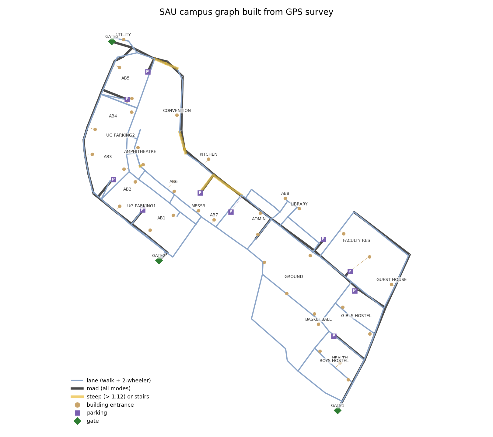
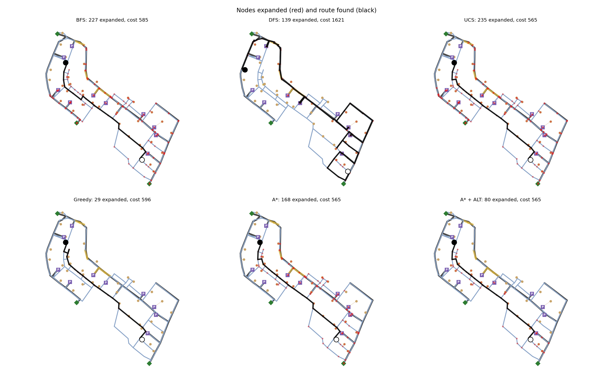
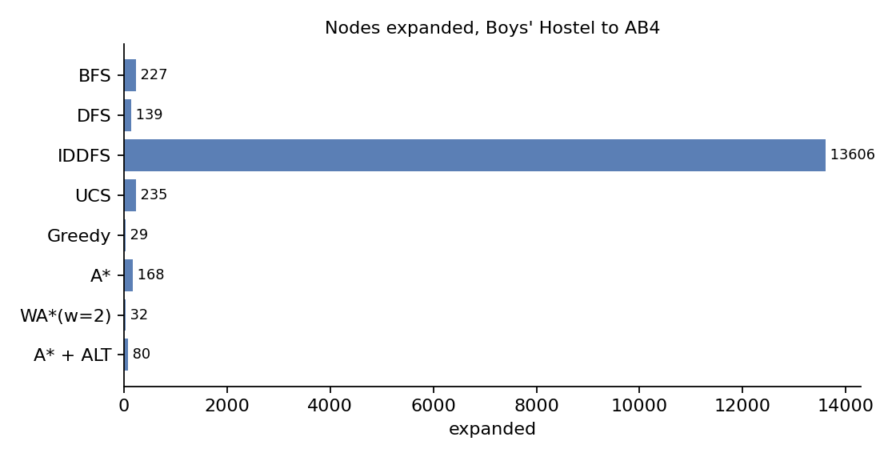
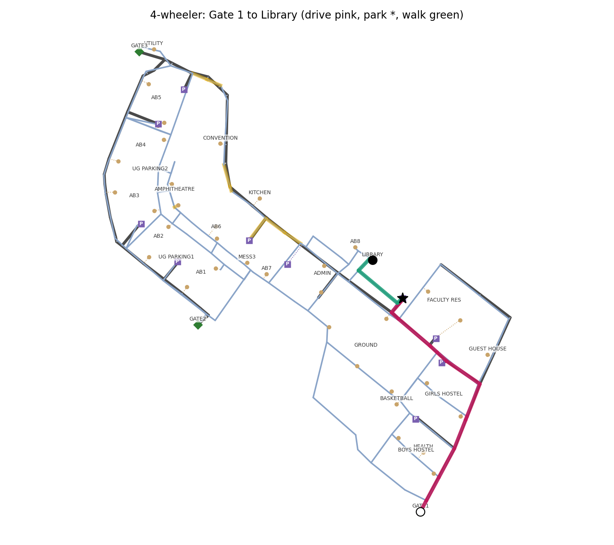
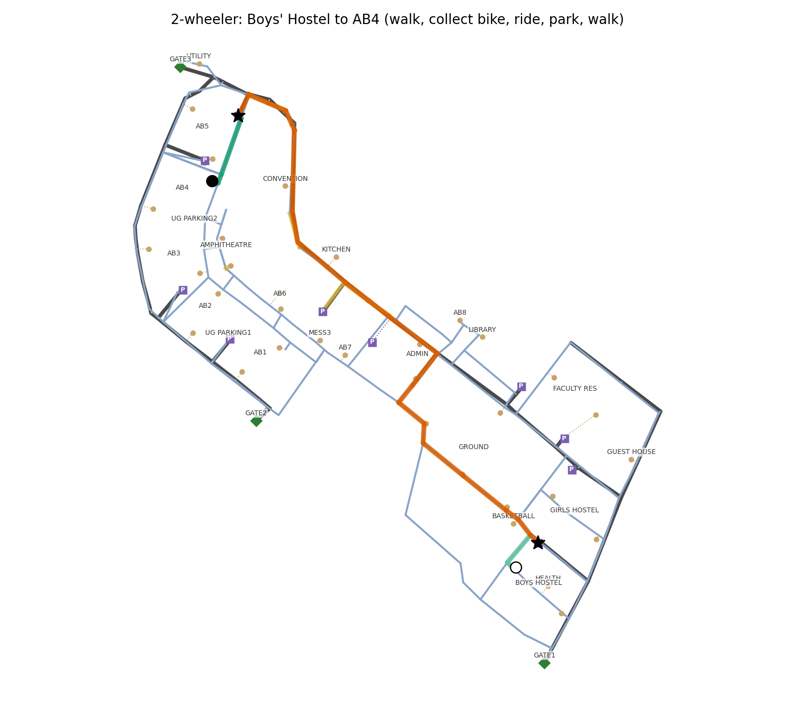
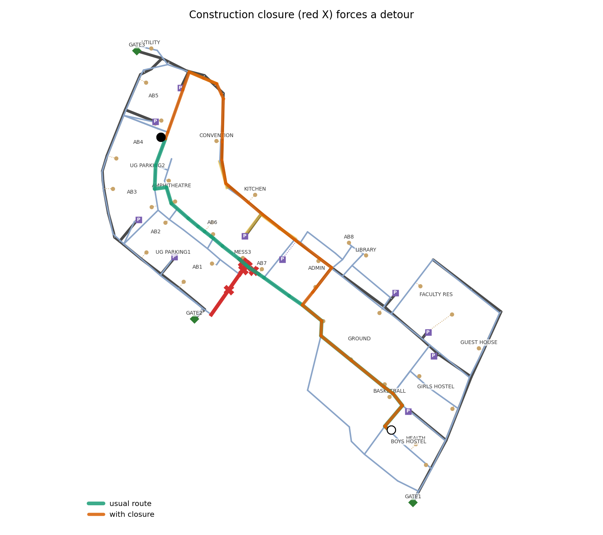
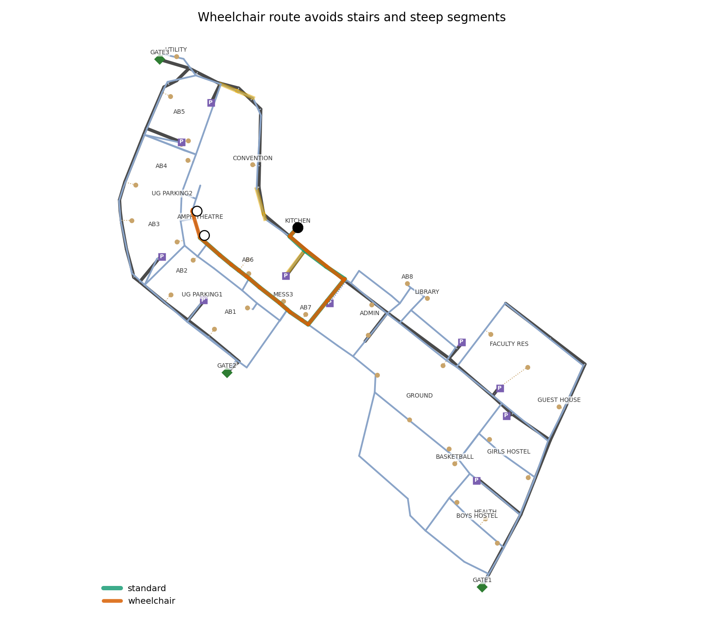
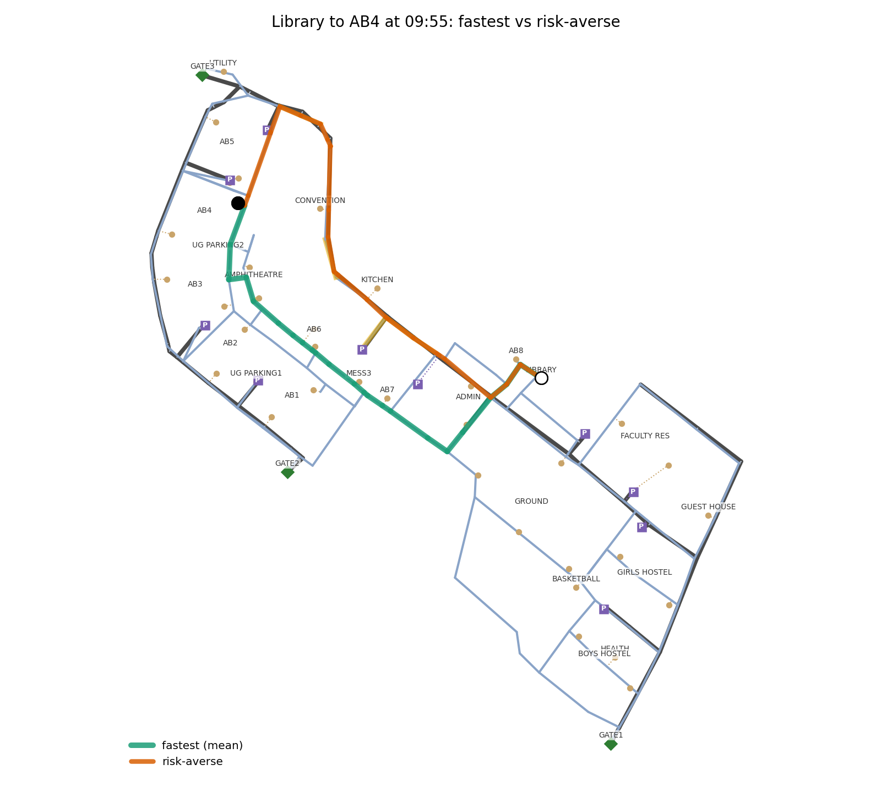
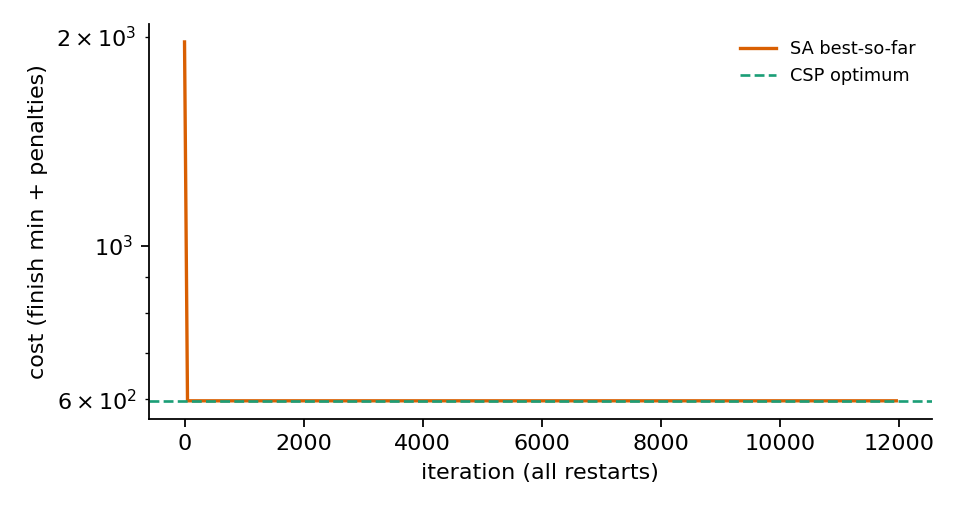

# SAU Smart Campus Navigator: demo results

Generated by `python demo.py`. All numbers come from the surveyed SAU graph.

## 0. Campus graph

```
288 nodes, 408 edges, 27 places, 10 parking spots
  connector    86 edges      126 m
  entrance     39 edges      300 m
  gate          6 edges       18 m
  lane        173 edges     4687 m
  parking      20 edges       98 m
  road         84 edges     2026 m
```

7 lane segments are steeper than the 1:12 wheelchair limit (from survey altitudes).



## 1. Uninformed vs informed search (on foot, Boys' Hostel to AB4, minimise time)

| algorithm | found | cost | steps | expanded | generated | max_frontier | runtime_ms |
|---|---|---|---|---|---|---|---|
| BFS | True | 585.4 | 26 | 227 | 638 | 18 | 7.2 |
| DFS | True | 1620.7 | 110 | 139 | 422 | 89 | 4.14 |
| IDDFS | True | 624.0 | 26 | 13606 | 35610 | 22 | 233.79 |
| UCS | True | 565.3 | 27 | 235 | 662 | 14 | 10.26 |
| Greedy | True | 596.4 | 29 | 29 | 81 | 26 | 1.73 |
| A* | True | 565.3 | 27 | 168 | 461 | 39 | 6.07 |
| WA*(w=2) | True | 565.3 | 27 | 32 | 86 | 24 | 2.84 |
| A* + ALT | True | 565.3 | 27 | 80 | 196 | 22 | 6.44 |

Cost is expected seconds. BFS minimises *steps*, not time; DFS returns the first route it stumbles on. UCS and A* both return the optimum, but A* (straight-line heuristic) expands fewer nodes, and the landmark (ALT) heuristic is tighter still. Weighted A* (w=2) expands the fewest nodes; it is only guaranteed within 2x of optimal, though here it happens to find the optimum.





**Average over all place pairs (walking, time):**

| algorithm | avg expanded | total cost vs optimal |
|---|---|---|
| UCS | 151.7 | 1.000x |
| A* | 67.1 | 1.000x |
| A* + ALT | 41.8 | 1.000x |
| Greedy | 21.0 | 1.107x |
| BFS | 147.4 | 1.059x |

## 2. Vehicle modes: who may use which path

| layer | walk | 2-wheeler | 4-wheeler |
|---|---|---|---|
| lane (SAU_Project_1) | yes | yes | no |
| road (Vehicle-only route) | yes | yes | yes |
| entrance link | yes | no | no |

Vehicles must park at one of the 10 parking spots; A* chooses the spot as part of the search.

**walk**
```
Gate No.1  ->  Central Library Entrance
  * Walk 487 m via lane/road
  Total 487 m, about 6.2 min (A*, 80 nodes expanded)
```

**2-wheeler**
```
Gate No.1  ->  Central Library Entrance
  * Ride 395 m via lane/road
  * Park at Library UG Parking
  * Walk 113 m via lane
  Total 508 m, about 4.0 min (A*, 174 nodes expanded)
```

**4-wheeler**
```
Gate No.1  ->  Central Library Entrance
  * Drive 398 m via road
  * Park at Library UG Parking
  * Walk 113 m via lane
  Total 511 m, about 5.6 min (A*, 106 nodes expanded)
```

**4-wheeler, student**
```
Gate No.3  ->  Faculty Residence Entrance
  * Drive 607 m via road
  * Park at Library UG Parking
  * Walk 111 m via lane/road
  Total 718 m, about 6.3 min (A*, 109 nodes expanded)
```

**4-wheeler, faculty**
```
Gate No.3  ->  Faculty Residence Entrance2
  * Drive 667 m via road
  * Park at Faculty Parking
  * Walk 45 m
  Total 713 m, about 5.6 min (A*, 104 nodes expanded)
```

**2-wheeler from hostel**
```
Boys' Hotel Entrance  ->  AB 4 Entrance2
  * Walk 68 m via lane
  * Collect your bike at Boys' Hostel Parking
  * Ride 729 m via lane/road
  * Park at UG Parking 3
  * Walk 90 m via lane
  Total 886 m, about 7.1 min (A*, 415 nodes expanded)
```

**4-wheeler from hostel**
```
Boys' Hotel Entrance  ->  AB 4 Entrance2
  * Walk 645 m via lane
  Total 645 m, about 9.4 min (A*, 323 nodes expanded)
```

Note the last case: fetching the car (3 min) and parking it again (3 min) costs more than walking, so the agent leaves it parked. Faculty may use Faculty Parking; students may not (rules in `data/overrides.json`).





## 3. Closures

Closing a 10 m radius around the midpoint of the normal route blocks 6 edges.
```
Before:
Boys' Hotel Entrance  ->  AB 4 Entrance2
  * Walk 645 m via lane
  Total 645 m, about 9.4 min (A*, 168 nodes expanded)

After closure:
Boys' Hotel Entrance  ->  AB 4 Entrance2
  * Walk 851 m via lane/road
  Total 851 m, about 11.2 min (A*, 164 nodes expanded)
```



**Car entrance of Library UG Parking closed** (cars only; pedestrians and 2-wheelers unaffected):

```
Gate No.1  ->  Central Library Entrance
  * Drive 398 m via road
  * Park at Library UG Parking
  * Walk 113 m via lane
  Total 511 m, about 5.6 min (A*, 106 nodes expanded)

After closure, 4-wheeler:
Gate No.1  ->  Central Library Entrance
  * Drive 568 m via road
  * Park at Admin UG Parking
  * Walk 171 m via lane/road
  Total 739 m, about 6.9 min (A*, 121 nodes expanded)

After closure, 2-wheeler (still allowed in):
Gate No.1  ->  Central Library Entrance
  * Ride 395 m via lane/road
  * Park at Library UG Parking
  * Walk 113 m via lane
  Total 508 m, about 4.0 min (A*, 174 nodes expanded)
```

The agent re-chooses the parking spot as part of the same A* search.

**Discovering a closure mid-trip (online replanning):**

- plan: 28 nodes, expected 9.4 min
- at node 70 the agent sees edge(s) [128] closed and replans from there: 7.2 min remaining
- reached goal: True

## 4. Accessibility

```
Standard:
Amphitheatre Entrance 2  ->  Central Kitchen Entrance
  * Walk 360 m via lane
  Total 360 m, about 5.1 min (A*, 59 nodes expanded)

Wheelchair:
Amphitheatre Entrance1  ->  Central Kitchen Entrance
  * Walk 398 m via lane/road
  Total 398 m, about 8.4 min (A*, 61 nodes expanded)
```

The wheelchair profile forbids edges with stairs (`overrides.json`) or a grade above 1:12, slows down on grades above 5 %, and uses 0.9 m/s.

81 of 351 shortest walking routes include a segment steeper than 1:12; the wheelchair profile reroutes all of them.



Preference `avoid_roads=1.6` (pedestrian dislikes vehicle roads): Gate 3 to UG Parking 2 goes 189 m to 220 m, staying on the lane.

## 5. Travel-time uncertainty

Edge times are log-normal; hotspots (mess at lunch, academic blocks at class change, main gate at rush hour) raise both mean and variance. Monte Carlo: 5000 samples.

| trip | depart | objective | distance m | mean s | p95 s | p95-p50 spread | P(on time, 487 s) |
|---|---|---|---|---|---|---|---|
| AB1 to CONVENTION | 10:00 | time | 378 | 303 | 329 | 27 | - |
| AB1 to CONVENTION | 13:00 | time | 488 | 391 | 421 | 32 | - |
| LIBRARY to AB4 | 09:55 | time | 512 | 463 | 517 | 56 | 0.79 |
| LIBRARY to AB4 | 09:55 | safe | 579 | 463 | 494 | 31 | 0.90 |

At 13:00 the fastest AB1 to Convention route bends away from the busy mess area. At 09:55 (class change) the fastest Library to AB4 route cuts through the academic-block crowd: a lower mean but a wide spread. The risk-averse objective (mean + 1.5 sd per edge) picks a route that is slower on average but far more predictable, so with an 8.1-minute deadline it is on time much more often. Fastest-on-average is not the same as most likely to be on time.



## 6. Multi-stop routing under deadlines (CSP + local search)

Start Boys' Hostel 09:00. Health Centre before 09:15; Admin opens 09:10, deadline 09:20, 10 min there; Library (8 min) **before** AB3; Mess 3 opens 09:30, 15 min; AB3 by 10:00; finish at AB4 by 10:10.

Travel-time matrix: 42 A* searches, 2438 nodes expanded, 121.9 ms.

```
[CSP backtracking] order: HEALTH -> ADMIN -> LIBRARY -> MESS3 -> AB3  (feasible; finish 09:57)
   arrive HEALTH         09:01 (deadline 09:15)
   arrive ADMIN          09:10 (deadline 09:20)
   arrive LIBRARY        09:22
   arrive MESS3          09:33
   arrive AB3            09:51 (deadline 10:00)
   arrive AB4 (end)      09:57 (deadline 10:10)
   nodes=8, pruned_deadline=0, pruned_forward_check=5, pruned_bound=1, pruned_precedence=3, ms=0.28
```

```
[Plain backtracking] order: HEALTH -> ADMIN -> LIBRARY -> MESS3 -> AB3  (feasible; finish 09:57)
   arrive HEALTH         09:01 (deadline 09:15)
   arrive ADMIN          09:10 (deadline 09:20)
   arrive LIBRARY        09:22
   arrive MESS3          09:33
   arrive AB3            09:51 (deadline 10:00)
   arrive AB4 (end)      09:57 (deadline 10:10)
   nodes=37, pruned_deadline=37, pruned_forward_check=0, pruned_bound=0, pruned_precedence=8, ms=0.27
```

```
[Brute force] order: HEALTH -> ADMIN -> LIBRARY -> MESS3 -> AB3  (feasible; finish 09:57)
   arrive HEALTH         09:01 (deadline 09:15)
   arrive ADMIN          09:10 (deadline 09:20)
   arrive LIBRARY        09:22
   arrive MESS3          09:33
   arrive AB3            09:51 (deadline 10:00)
   arrive AB4 (end)      09:57 (deadline 10:10)
   orders=120, ms=3.1
```

```
[Simulated annealing] order: HEALTH -> ADMIN -> LIBRARY -> MESS3 -> AB3  (feasible; finish 09:57)
   arrive HEALTH         09:01 (deadline 09:15)
   arrive ADMIN          09:10 (deadline 09:20)
   arrive LIBRARY        09:22
   arrive MESS3          09:33
   arrive AB3            09:51 (deadline 10:00)
   arrive AB4 (end)      09:57 (deadline 10:10)
   evaluations=12003, accepted=327, restarts=3, ms=625.3
```

```
[Hill climbing (restarts)] order: HEALTH -> ADMIN -> LIBRARY -> MESS3 -> AB3  (feasible; finish 09:57)
   arrive HEALTH         09:01 (deadline 09:15)
   arrive ADMIN          09:10 (deadline 09:20)
   arrive LIBRARY        09:22
   arrive MESS3          09:33
   arrive AB3            09:51 (deadline 10:00)
   arrive AB4 (end)      09:57 (deadline 10:10)
   evaluations=680, restarts=10, ms=20.7
```

Monte Carlo P(every deadline met) for the CSP plan: **1.00**



**Scaling to 9 stops** (9! = 362,880 orders):

| method | feasible | finish | work | ms |
|---|---|---|---|---|
| CSP backtracking | True | 57.7 min | 700 | 29.91 |
| Simulated annealing | True | 57.7 min | 18003 | 755.0 |
| Hill climbing (restarts) | True | 57.7 min | 4824 | 138.0 |

**Infeasible request:**

```
[CSP backtracking] order:   (VIOLATES DEADLINES; finish --:--)
   why: AB4: even going there first you arrive 09:09, after its deadline 09:04
   nodes=1, pruned_deadline=1, pruned_forward_check=1, pruned_bound=0, pruned_precedence=0, ms=0.05

[Simulated annealing] order: AB4 -> LIBRARY  (VIOLATES DEADLINES; finish 09:27)
   arrive AB4            09:09 (deadline 09:04)   LATE by 5.4 min
   arrive LIBRARY        09:22
   evaluations=12003, accepted=2, restarts=3, ms=233.9
```

CSP proves no order works and says why; local search still returns the least-late order.

Interactive satellite map: `outputs/campus_map.html` (needs internet for ESRI satellite tiles).
Interactive vector application: `web/index.html` (or `outputs/navigator_app.html`).